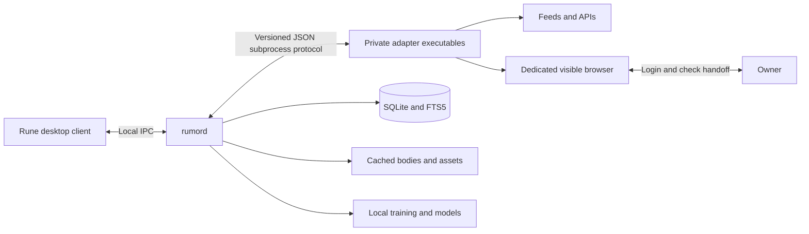

# Process and data ownership

Accepted design, 10 November 2026. The public provider contract/process host and synthetic provider exist; desktop, daemon, persistence and learning are not implemented yet.

The daemon owns writes, jobs, checkpoints and source credentials. The Rune client dispatches application commands and displays state through IPC; closing it leaves jobs running. Start/stop/pause/reconnect are explicit operations. No in-process UI timer substitutes for the daemon.

Keep IPC input validation, versioning, user/peer permissions and request IDs at the boundary. Use transactions for feedback-plus-queue operations and durable checkpoints for retryable collection. The daemon must remain usable without a graphics device, browser window or reader process.

Each adapter has its own private repository and runs as a separately installed trusted executable. The public app owns protocol validation and shared host controls; private implementations discover metadata, fetch/extract content and drive a dedicated browser. The browser worker is not the Rune client. Pause jobs for manual browser intervention, retain partial progress, and revalidate before importing. Keep browser profiles, articles, feedback and credentials outside the source tree. Fixture mode uses temporary directories and synthetic data without live network calls.

Canonical article identity is distinct from discovery channels and reversible story groups. Seen, explicit preference, queue membership and read state are separate. Fetched HTML is untrusted and sanitization is independent of extraction. ML features use only permitted information available when the headline was presented.

Current Cargo members are `crates/core` and `crates/provider-fixture`. Add `crates/desktop` and `crates/daemon` with real behavior when their dependencies/implementation are ready. All source-adapter implementations are in private sibling repositories and are not members or dependencies of this workspace, including optional dependencies. Shared protocol/domain types must not pull Rune into core/daemon. Do not create empty crates simply to make the layout appear implemented.

The daemon/core can later serve a personal HTTP API. Website/mobile synchronization and service authentication are later scope. See [FEATURES.md](../FEATURES.md) for the public product scope.
